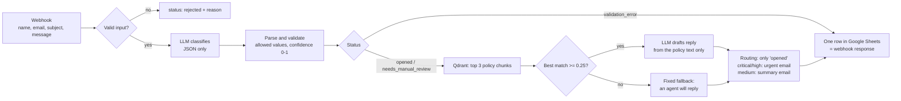
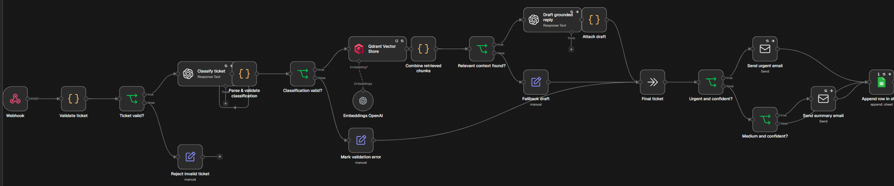
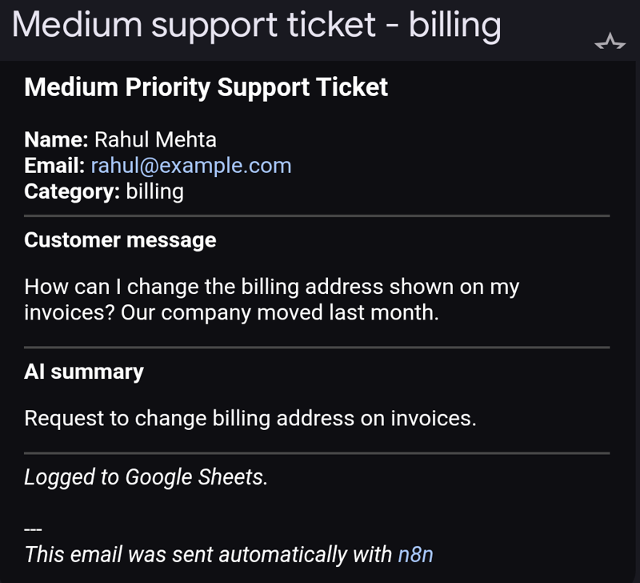

# AI support-ticket pipeline (n8n + OpenAI + Qdrant RAG)

An n8n workflow that takes customer support tickets from a webhook, classifies them with an LLM, finds the matching company policy in a Qdrant vector database (RAG), drafts a reply grounded only in that policy, alerts the team for urgent tickets and logs every ticket to Google Sheets.

**The AI classifies, searches and drafts. Rules make every decision:** validation, status, fallback, routing and logging are plain logic, and nothing the model returns is used before it is checked.

Built as a take-home case study for a working-student role, with a fictional company ("NOAVIA") and its five short policy documents.

## How a ticket flows



The workflow in n8n:



| Status | Meaning | Email to team | Reply shown to the customer |
|---|---|---|---|
| `opened` | Valid classification, confidence >= 0.6, message long enough to judge | critical/high: urgent; medium: summary; low: none | yes |
| `needs_manual_review` | Confidence below 0.6, or the message is under 5 words | none | no, a person takes over |
| `validation_error` | The model's answer could not be parsed or had invalid values | none | no |
| `rejected` | Missing field or invalid email format | none (not logged) | the form shows the reason |

The calling help-desk system receives the logged row as the webhook response (classification, draft, sources, status) and shows the draft only for `opened` tickets.

## Test results

Six test tickets cover every path (`tests/test_tickets.ps1`, or `tests/test_tickets.sh` on macOS/Linux). Latest run, November 2026:

| # | Ticket | Result |
|---|---|---|
| 1 | "Charged twice, want my money back" (angry) | refund, high, negative, 0.9 -> opened; refund policy retrieved first; urgent email sent; draft quotes "refunded automatically after verification" and "3-5 business days" |
| 2 | "How can I change the billing address on my invoices?" | billing, medium -> opened; Billing FAQ; summary email |
| 3 | "How do I reset my password?" | account -> opened; draft points to "Forgot Password" (urgency rated medium, see limits) |
| 4 | "it doesn't work" | needs_manual_review; no relevant policy (similarity 0.10) -> fallback |
| 5 | "Can I bring my dog to your office?" | other, low -> needs_manual_review; fallback, nothing invented |
| 6 | Invalid email address | rejected: "invalid email format" |

Testing my own first version found real problems: low-confidence tickets still sent emails, top-3 retrieval created three parallel runs (duplicate drafts and emails), a wiring error dropped low-urgency tickets, and a vague ticket was rated 0.85 confident by the model. All are fixed and re-tested; details in [docs/CHANGELOG.md](docs/CHANGELOG.md).

Summary email the team received for ticket 2 (test data):



## Design decisions

- **Validate model output before acting on it.** The classifier returns JSON only; a code node strips code fences, parses it and checks every field against the allowed values. Anything invalid becomes `validation_error` and triggers nothing.
- **Do not trust the model's confidence alone.** Testing showed the model rating a three-word ticket 0.85 confident. The prompt now asks for at most 0.4 when the problem is unclear, and a code rule sends messages under 5 words to manual review regardless.
- **Merge retrieved chunks into one item.** In n8n every item runs through the following nodes separately; three chunks meant three drafts and duplicate emails. The chunks are combined so everything after runs once, and the draft sees all three.
- **Grounded drafts with a safe fallback.** The draft prompt may only use the retrieved policy text. Below a similarity of 0.25, no model is called: a fixed reply says an agent will follow up.
- **Only confident tickets act.** Emails and customer-facing replies require status `opened`; everything else goes to a person.
- **Temperature 0 for classification**, so the same ticket gets the same label.
- **n8n for orchestration.** The job is connecting a webhook, OpenAI, Qdrant, SMTP and Google Sheets with simple routing, which n8n does with native nodes and keeps visible to non-engineers. Complex, rule-heavy logic would belong in a tested code service.

## RAG setup

- **Ingestion** (`workflows/kb_ingestion.json`, run once or when policies change): read the Markdown files in `knowledge/` -> split into 500-character chunks with 50 overlap -> OpenAI embeddings (1536 dimensions) -> Qdrant collection `support_kb`. The five policies are short, so each is a single chunk; chunking matters once documents grow.
- **Retrieval** (per ticket): subject + message are embedded with the same model; Qdrant returns the 3 most similar chunks with their scores.

## Run it locally

Requirements: Docker Desktop, an OpenAI API key; for the optional steps a Gmail app password (SMTP) and a Google Cloud OAuth client (Sheets).

```
cp .env.example .env          # optional: time zone
docker compose up -d          # n8n on http://localhost:5678, Qdrant on :6333
```

1. Open n8n, create the owner account, and add credentials: **OpenAI**, **Qdrant** (URL `http://qdrant:6333`), and optionally **SMTP** and **Google Sheets OAuth2**.
2. Import `workflows/kb_ingestion.json`, select the credentials, run it once (Qdrant then holds 5 points).
3. Import `workflows/ticket_processing.json`, select the credentials, set your team email address in the two email nodes and your sheet ID in the Sheets node (or deactivate those three nodes: deactivated nodes pass data through), then publish.
4. Run the tests: `powershell -ExecutionPolicy Bypass -File tests\test_tickets.ps1` or `./tests/test_tickets.sh`.

API keys live only in n8n's encrypted credential store, never in the workflow files.

## Repository layout

```
workflows/   kb_ingestion.json, ticket_processing.json (n8n exports, no credentials)
knowledge/   the five policy documents used for RAG
tests/       six test tickets (PowerShell and bash)
docs/        changelog of what testing found and fixed
docker-compose.yml, .env.example
```

## Limits and next steps

- **No measured accuracy yet:** six hand-made test tickets, not a labelled dataset. Next: a few hundred labelled tickets to measure classification accuracy and tune the 0.6 and 0.25 thresholds.
- **Urgency is generous:** a simple password question was rated medium. Next: explicit urgency definitions in the prompt.
- **LLM confidence is only a filter:** it should be calibrated against real outcomes before more replies are automated.
- **Re-running ingestion adds duplicate vectors;** it should clear or update the collection first.
- **Google Sheets is a pilot log;** production would log to the help-desk system or a database.
- **Errors continue rather than alert:** next, an n8n error workflow that notifies someone.
